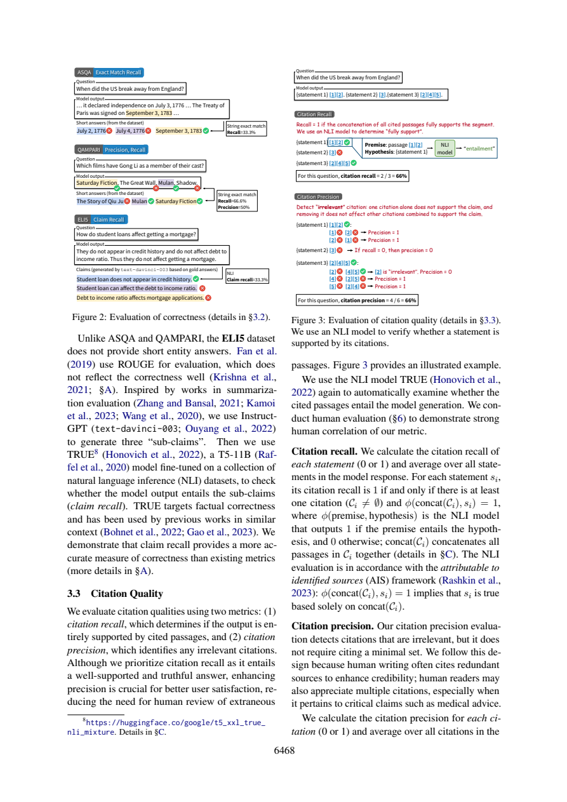

# 引用精度不等于最小引用集

这份分享解决一个具体的论文阅读问题，采用“先冻结问题与验收标准→编号原文→真实AI回答→严格定位→语义核查”的流程。范围、任务和作者判断在下文明确分开；不是对原论文实验的复现，也没有宣称模型、提示词或工作流普遍更优。此前我在同项目阅读过这两篇论文；本次主题与既有query位置干预文章不同，实际调用也是新产生的。

## 先把条件写全，再判断“冗余”

论文的 citation recall 按 statement 平均：每句得0或1；有引用且拼接全部引用后NLI判定蕴含该句才得1。citation precision则按引用平均。它不要求最小引用集。主文物理页4（印刷6468）§3.3明确写出“does not require citing a minimal set”，页5（6469）续写形式条件：

`irrelevant(c) = [phi(c,s)=0] AND [phi(concat(C\{c}),s)=1]`。

单条precision=1还要求该句recall=1，且该条不irrelevant。不能只保留“移除不影响”一半条件。两条引用各自都完全支持一句时，移除其中一条后确实仍能支持；但该条自身不支持这一条件为假，所以并不因冗余而受罚。这个反例是按定义推导的教学例子，不是论文新增实验。

|情况（假定句子联合recall=1）|自身支持|移除后其余支持|irrelevant|
|---|---:|---:|---:|
|两条各自完整支持，检查任一条|1|1|否|
|无关的一条，其余已完整支持|0|1|是|
|仅部分支持的一条，其余也支持整句|0（按二值NLI）|1|会被罚，可能不符合细粒度人工判断|

最后一行正是附录E（物理15/印刷6479）讨论的局限：有贡献的部分支持可能被当作irrelevant。它不意味着所有部分引用都会被罚；“其余仍支持”也必须成立。论文的基于来源支持关系与世界事实正确性也不同：即使蕴含判对，来源本身仍可能错。该区分是方法学判断，不能全归为附录E已经做过的实测。



Figure3在本页右上：recall示例按3句平均，precision按6条引用平均。左侧Figure2是correctness，不是precision；抽取文本的阅读顺序不能代替页面布局。

## 新调用暴露的问题

原答能解释AND条件，并正确推导两条各自完整支持时不受冗余惩罚。但D1实际回答了“是否最小集”，D2才回答recall分母，和task要求的D1/D2对应错位；D2也没有单独完整回答它应负责的irrelevant条件。若程序按id使用，语义内容散落在其它项不能自动算该项正确。D4把附录局限概括为“仅部分但联合完整就会错罚”，缺了移除后其余仍支持的条件，过宽。

另一个定位问题是D1的ALCE-P5:17–29夹入上一段示例，核心公式主要在21–29；D2引用P4:94–96只是Figure3尾部标签，需要110–122的正式定义才支撑分母。原答虽方向有用，仍应拒绝自动按D1/D2入库。改进建议是按每项问题逐项核对语义映射、将两条件显式列为字段；本次没有重新调用验证该建议。

## 真实记录与复做

本次一轮Bohrium CLI2.8.1原生调用，请求gpt-5-mini/photon，实际返回chenkun/gpt-5-mini。无历史无工具，180秒预算，实际墙钟（含预检及客户端开销）25.856秒，输入4531、输出2827 tokens。completion ID见metadata；精确snapshot/temperature/seed不可得。费用无逐次货币信息，cost=null，不能当0。正文判断由Codex辅助非盲核查，不伪装独立人类评审。

完整[实际输入](run-request.txt)、[预检](run-preflight.json)、[原始响应](run-response.json)、[模型原答](run-output.json)、[元数据](run-metadata.json)、[stderr](run-stderr.txt)均保留。response仅脱敏私人余额。没有重写原答，也没有失败后挑选新答案。本次严格JSON/行范围结果为`ranges_valid`，共11段；这只检查id覆盖、字段存在与行范围，不检测问题语义对应、单位、蕴含或原文是否充分。

本地复查（Python3标准库、无需联网）：

```sh
python validate.py sources.json run-output.json
```

预期ranges_valid，exit0；请继续逐项比对[编号原文](numbered.txt)、正文审计与[调用前标准](criteria.md)。D1–D4标签存在不表示它们分别答对了问题。

独立重做需从玻尔官方渠道安装Bohrium CLI并手动登录，确保额度。保留这些文件同目录，用原生exe或对应系统原生二进制：

```sh
python replay.py --bohr /absolute/path/to/bohr --condition workflow --out new-run
```

replay先dry-run逐字验证实际message，再调用；现有out拒绝覆盖。Windows .cmd历史上会截断多行参数，原生exe避免这一已遇到的问题；命令行仍需低于Windows长度限制。若代理影响认证，本脚本仅移除子进程HTTP_PROXY/HTTPS_PROXY/ALL_PROXY及小写变量，不修改系统代理。真实输入含非语义UUID，新调用不保证逐字相同，按预先标准核验。失败记录不应删改，网络失败不得伪造成功。

## 文件导航与许可

[task.txt](task.txt)列出确切四项问题；[workflow.txt](workflow.txt)为本次方法；[protocol.md](protocol.md)为运行约束；[protocol-lock.json](protocol-lock.json)记录六个事前文件SHA256（对应本目录同名文件）。[sources.json](sources.json)保留原文页面、物理页和source_id，[SOURCES.md](SOURCES.md)说明作者、版本、页码、原PDF哈希与许可。图是原页核查材料，关键结论都另有文字，不依赖看图取数。

[validate.py](validate.py)是机械检查器；[replay.py](replay.py)保存全新请求与响应。只有本次输入输出进入本作品，未把旧实验重复包装。论文采用CC-BY4.0，原创文字与代码MIT。来源研究归论文作者；本次贡献是具体问题设计、适配编号流程、一次实际玻尔阅读、对原答缺陷的原文核查及可照做教程。
